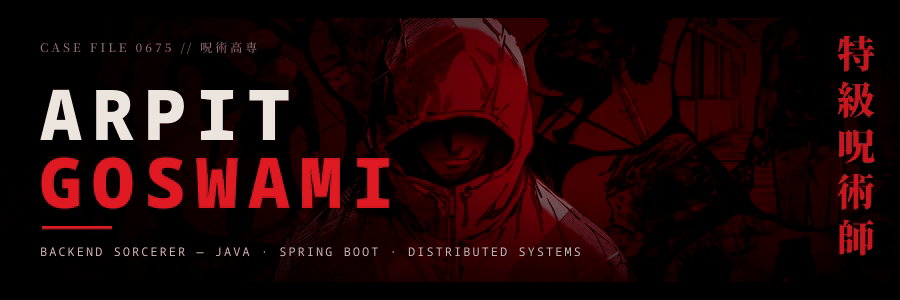
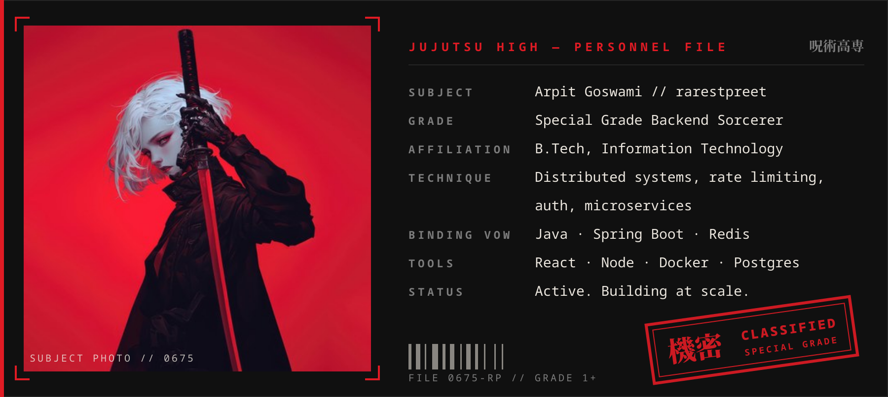
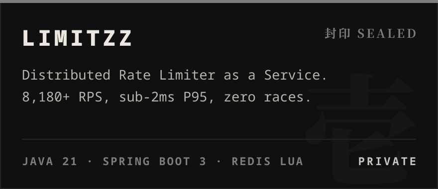
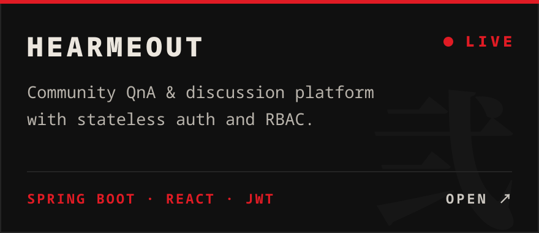
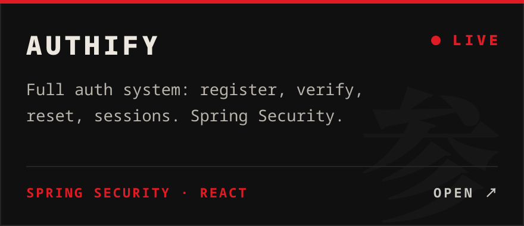
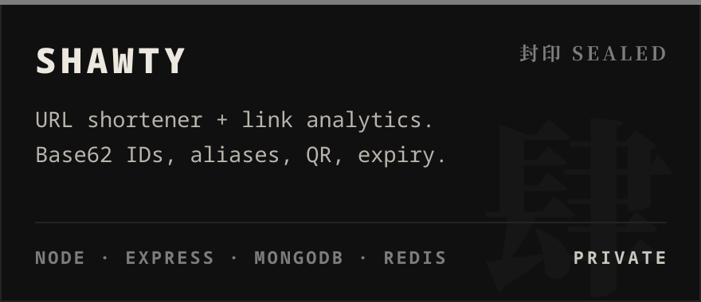
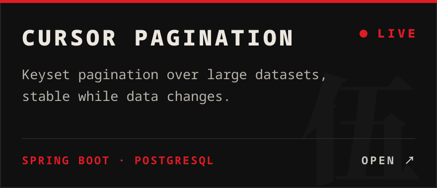
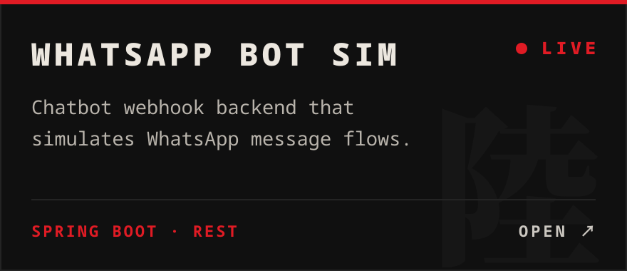
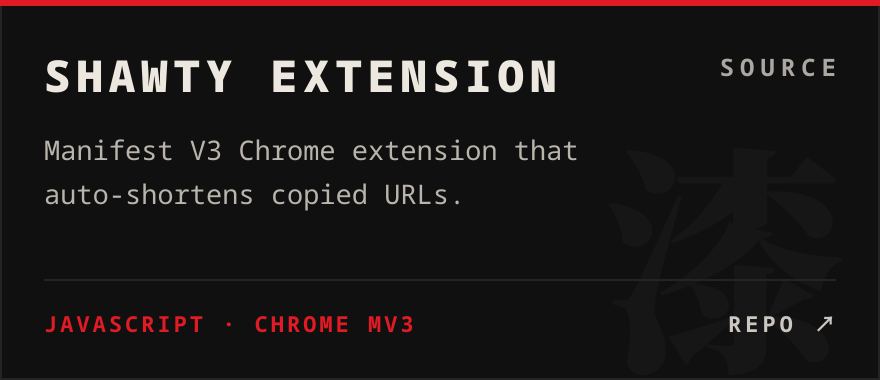
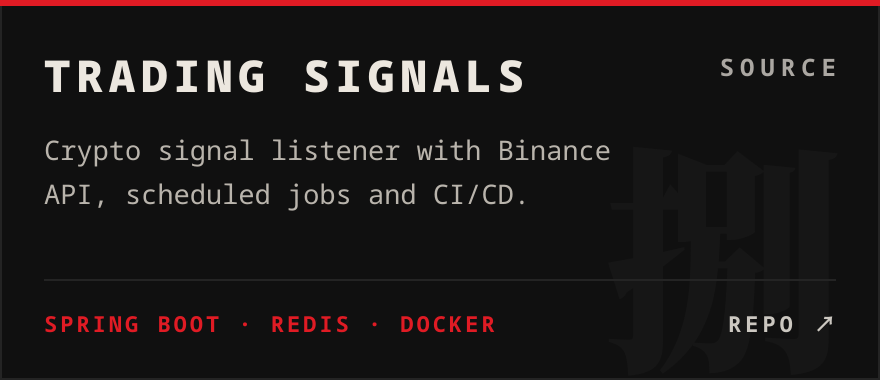

<!--
Art in assets/ is built by scripts/build_assets.py (edit PROJECTS / DOSSIER there, rerun).
Stats, languages and history cards are generated daily by .github/workflows/profile.yml
(scripts/profile_cards.py) into the "output" branch.
-->

  

  
  

 

  

  
  
  
  

  
    <b>SOURCE</b> &nbsp;·&nbsp;
    HearMeOut <a href="https://github.com/rarestpreet/community-qna-platform-frontend-react">fe</a>/<a href="https://github.com/rarestpreet/community-qna-platform-backend-springboot">be</a> &nbsp;·&nbsp;
    Authify <a href="https://github.com/rarestpreet/authentication-system-frontend-react">fe</a>/<a href="https://github.com/rarestpreet/authentication-system-backend-springboot">be</a>/<a href="https://authify-backend-c1zq.onrender.com/api">api</a> &nbsp;·&nbsp;
    <a href="https://github.com/rarestpreet/spring-boot-cursor-pagination">Cursor Pagination</a> &nbsp;·&nbsp;
    <a href="https://github.com/rarestpreet/whatsapp-chatbot-backend-simulation">WhatsApp Bot</a>
     
    <b>SIDE QUESTS</b> &nbsp;·&nbsp;
    <a href="https://todesktop-preet.vercel.app/">ToDesktop Clone ↗</a> &nbsp;·&nbsp;
    <a href="https://rarestpreet.github.io/tic-tac-toe/">Tic-Tac-Toe ↗</a> &nbsp;·&nbsp;
    <a href="https://github.com/rarestpreet/ai-powered-fitness-microservice">AI Fitness Microservices</a>
     
    <i>封印 sealed = private repo, click to request access. Live demos are on Render's free tier, so the first load can take ~30s.</i>
  

 

  

  

 

  
  

 

  

  

 

  

  
  
  
  

━━━━━━ ⛩ &nbsp; END OF FILE 0675 &nbsp; ⛩ ━━━━━━

